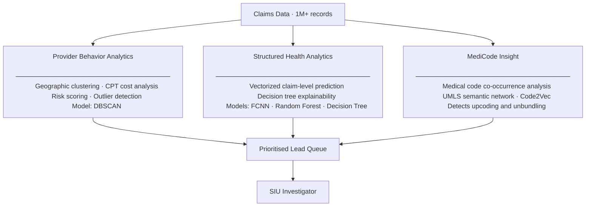
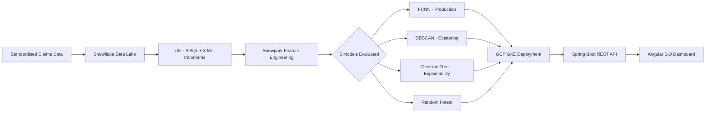

# Healthcare Fraud Detection AI — Product Case Study

> **When Your AI Product Has to Explain Itself to Sceptics**
> A PM case study on shipping fraud detection AI to healthcare investigators at Carelon (Elevance Health)

---

> **Confidentiality notice:** This repo uses public CMS Medicare data for the demo notebook. Carelon-specific figures, internal programme names, and internal tool names have been adjusted or generalized for external publication. The product decisions, architecture patterns, and PM frameworks reflect real work; specific numbers are illustrative.

---

## What Is This, and Who Is It For?

**If you're not in healthcare or insurance — start here.**

This repo documents a real AI product built at Carelon (a healthcare services company within Elevance Health). Here's the plain-English context:

**FWA (Fraud, Waste, and Abuse)**
The healthcare industry loses hundreds of billions annually to improper billing — providers billing for services never rendered, inflating procedure codes, or coordinating schemes across provider networks. Insurance companies have dedicated teams whose job is to find and stop this.

**SIU (Special Investigation Unit)**
The investigators who work these cases. Think: fraud analysts, but for healthcare claims. They review flagged providers, build evidence dossiers, and refer cases for formal action. Every case decision they make is documented and must be defensible — to supervisors, legal, and regulators.

**PAD (Provider Anomaly Detection)**
The AI application built at Carelon. It analyzes 1M+ healthcare claims per month, scores providers for fraud risk using three AI engines, and gives investigators a ranked lead queue — replacing a fragmented manual process that required opening three separate tools every morning and reconciling results in Excel.

**The core challenge:** Getting investigators to trust AI recommendations when their professional reputation depends on every case they open.

---

## What This Is

This repo documents the product thinking behind a healthcare AI initiative at Carelon (Elevance Health). The focus: building AI that SIU investigators would actually use — not just a model that scores well on a holdout set.

**The PM role:** Not building the models. What was owned: defining what the AI needed to do, making the product decisions that shaped the technical approach, and closing the gap between model performance and investigator adoption.

This repo includes:
- [Architecture documentation](architecture/) — system design and ML pipeline
- [PM artifacts](pm-artifacts/) — the frameworks used to make AI product decisions
- [Demo notebook](notebooks/) — EDA on public CMS Medicare data to illustrate the detection patterns

---

## The Problem

SIU investigators were fragmented across three legacy investigation dashboards. Core pain points:

1. **Volume**: 1M+ claims to analyze — impossible to manually prioritize
2. **Fragmentation**: Three tools, three contexts, 2–3 hours of overhead every morning before investigation even started
3. **Detection gaps**: Sophisticated FWA schemes (multi-provider coordination, systematic upcoding) invisible to rule-based tools
4. **No explainability**: Investigators couldn't justify their prioritization decisions to supervisors

The PAD application consolidated this with an ML-powered lead prioritization layer across three detection engines.

---

## Architecture Overview

### Three Analytics Engines



### ML Pipeline



**Full architecture detail:** [architecture/system-architecture.md](architecture/system-architecture.md)

---

## Key Product Decisions

### 1. Recall over Precision
Chose to optimize for recall (catch more fraud) over precision (fewer false positives). Rationale: a missed fraud case = direct financial loss; a false positive = recoverable investigator time. The cost asymmetry was clear and documented before training began.

### 2. Decision Tree Explainability as a Core Feature
FCNN was the top performer on holdout data. But Decision Tree path visualization was required in the SIU UI regardless — because investigators need to understand *why* before they'll act. A probability score they can't explain creates professional risk for them. Explainability as UX, not compliance.

### 3. Investigator Use Case Definition Before Model Training
Working sessions with SIU investigators to define what a "good lead" looked like before any feature engineering started. When investigators helped define the criteria, they trusted the output. This was the most important adoption lever — not the model performance.

### 4. CI/CD Evaluation Pipeline Before Any Deployment
No model shipped without passing 5 evaluation gates: Data Quality → Model Performance → Fairness/RAI → Shadow Mode (4-week parallel run) → Canary Deployment. Acceptance criteria were defined before training began, specifically to prevent anchoring bias. Full methodology (error asymmetry framework, explainability decisions, RAI governance), model comparison data, and 6-month monitoring results documented in [pm-artifacts/ai-evaluation-and-monitoring.md](pm-artifacts/ai-evaluation-and-monitoring.md).

---

## Outcome

### What Shipped
- Three-engine PAD application deployed into the SIU investigation workflow
- ML pipeline trained on 1M+ healthcare claims; FCNN selected as production model after 5-model evaluation
- Net-new FWA leads surfaced — cases invisible to legacy rule-based dashboards
- Contributing to significant annual FWA savings in a large-scale payment integrity programme

### Investigator Impact

| Metric | Before PAD | After PAD |
|---|---|---|
| Lead discovery time | ~2–3 hours/day | < 30 minutes/day |
| Cases reviewable per week | ~8–12 per investigator | 20–30 per investigator |
| Lead explainability | Investigator judgment only | Decision tree path + reason codes |
| Detection coverage | Rules-based patterns only | + ML patterns across all 3 engines |
| Cross-system correlation | Manual Excel matching | Automated composite scoring |

### How Success Was Measured

Success was defined across three levels — not just model metrics:

1. **Model quality:** Recall ≥ 70% on holdout data (set before training began); Precision@100 ≥ 40% in production
2. **Investigator adoption:** Lead queue utilization rate (% of cases opened via PAD vs legacy tools); time-to-first-action
3. **Business outcome:** Case conversion rate (ML-flagged leads → active investigations); override rate as ongoing model quality signal

Override rate became the most valuable post-launch signal. When Engine 1 showed a sustained elevated override rate on certain lead types, tracing the pattern revealed a model quality issue — specialty-specific providers (oncology, dialysis) were being compared to general practitioners in the peer grouping. Refining the clustering logic to segment by specialty type brought override rates down significantly within two months.

---

## PM Artifacts

Three documents cover the product decisions behind this work:

**[Problem Discovery and UX Strategy](pm-artifacts/problem-discovery-and-ux-strategy.md)**
How investigator working sessions changed the product direction — from "consolidate three dashboards" to a prioritization and explainability problem. Includes JTBD framing, detection gap analysis, and four UX decisions with options-considered evidence.

**[AI Evaluation and Monitoring](pm-artifacts/ai-evaluation-and-monitoring.md)**
The PM methodology before training begins (error asymmetry, explainability requirements, pre-written thresholds, RAI governance), the 5-gate CI/CD eval pipeline, 5-model comparison, shadow mode results, and 6-month post-launch monitoring including override rate diagnosis.

**[Recall vs. Precision Decision](pm-artifacts/recall-vs-precision-decision.md)**
The cost-asymmetry framework that drove the recall-first model selection decision, with the specific numbers that made it unambiguous.

---

## Contents

```
├── README.md                              ← You are here (case study overview)
├── architecture/
│   ├── system-architecture.md             ← Full system design with diagrams
│   └── investigator-workflow.md           ← Redirect → see pm-artifacts/problem-discovery-and-ux-strategy.md
├── pm-artifacts/
│   ├── problem-discovery-and-ux-strategy.md  ← Discovery process, JTBD framing, UX design decisions
│   ├── ai-evaluation-and-monitoring.md    ← PM methodology, CI/CD eval pipeline + 6-month monitoring
│   └── recall-vs-precision-decision.md    ← The cost-asymmetry framework
├── ui-mocks/
│   ├── pad-lead-queue.html                ← Investigator lead queue interface (interactive HTML)
│   └── pad-monitoring-dashboard.html      ← PM/DS model health monitoring dashboard (interactive HTML)
└── notebooks/
    ├── README.md                          ← What the demo covers + setup
    └── fraud-detection-eda.ipynb          ← EDA on public CMS Medicare data
```

---

## About

**Ngan Pham** — Senior PM, building AI for customer service operations at scale.
Previously: Carelon (Elevance Health) · Sleep.ai
Community: Product Garage (co-founder) · Women in AI Ireland

[LinkedIn](https://linkedin.com/in/nganpham) · [GitHub](https://github.com/ngankp)

---

*Note: This repo uses public CMS Medicare data for the demo notebook. All Carelon-specific figures, internal programme names, and internal tool names have been adjusted or generalized for external publication.*
