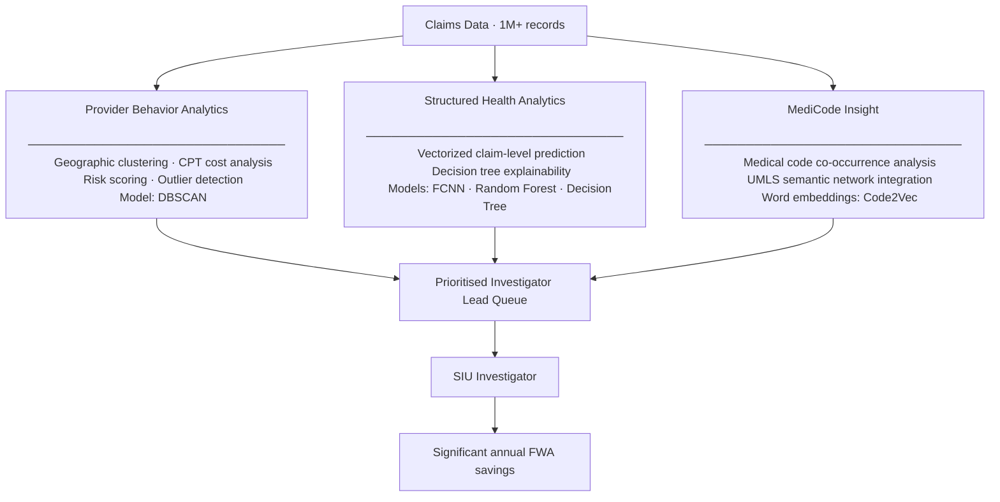

# When Your AI Product Has to Explain Itself to Sceptics
### What shipping fraud detection AI taught me about enterprise AI PM

---

In healthcare fraud detection, your model's AUC score doesn't matter if investigators won't use it.

I learned this the hard way during my time at Carelon (Elevance Health), where I led the product side of an AI initiative within a large-scale payment integrity programme responsible for over $300M in annual FWA recovery.

The data science was excellent. The model performance metrics looked strong. The investigators weren't impressed.

Here's what it took to change that.

---

## The Problem We Were Solving

Carelon's Special Investigation Unit (SIU) — the team that investigates healthcare fraud — was running a fragmented manual process across three separate legacy dashboards. Every morning started with 2–3 hours of overhead: log into each tool separately, pull results, cross-reference them in Excel, manually decide which of 200+ flagged providers to investigate first.

No priority ranking. No way to explain their prioritization to a supervisor if challenged. And sophisticated FWA schemes — multi-provider coordination, systematic medical code manipulation — simply weren't detectable with rule-based tools.

Investigators knew fraud was happening. They couldn't prove it from the data they had.

The opportunity: one interface, ML-powered lead prioritization, and a way to surface patterns no dashboard could find. My job was to define what that meant — and make sure it actually got used.

---

## My Role as PM

I didn't build the models. That's important to say clearly.

What I owned:

- **Use case definition** — running working sessions with SIU investigators to understand what signals they look for, and translating that instinct into ML feature requirements
- **The recall vs precision decision** — explicitly choosing to optimise for recall (catch more fraud) over precision (fewer false positives), because the cost of a missed fraud case outweighs the cost of an investigator reviewing a clean one
- **Scoping three distinct analytics engines**, each targeting a different detection pattern
- **Investigator adoption strategy** — identifying that explainability wasn't optional
- **Post-launch monitoring** — defining the signal hierarchy and failure thresholds before launch, not after

---

## The Architecture: Three Engines, One Platform

The PAD (Provider Anomaly Detection) application brought three AI engines into one interface:

Each engine targeted a specific FWA signal. Provider Behavior finds anomalous billing volumes and geographic outliers. Structured Health scores individual claims for FWA likelihood. MediCode Insight detects procedure code combinations that shouldn't co-occur — the fingerprint of systematic upcoding.

Five model types were evaluated across 1M+ claims. FCNN was the top performer on holdout data. The Decision Tree wasn't the best predictor — it was included because investigators needed to understand *why* a case was flagged, and a probability score wasn't enough.

That was a product decision.

---

## What the Investigator Experience Looked Like

The before state: investigators opened three tools, reconciled results in Excel, and used pure judgment to decide which 8–12 cases to work that week.

The after state: a single prioritized lead queue with three columns that mattered — priority tier, estimated case value, and flags across engines. Open any lead and you see why it was ranked there: the FCNN score, the decision tree path in plain English, and geographic context from the clustering engine.

The design decision that made the most difference: adding estimated financial recovery value next to each lead. Investigators had been routing Medium-priority leads based on personal judgment. Once they could see that a Medium-priority lead was worth $85K against a High-priority lead worth $12K, prioritization became consistent and defensible.

The UI is documented in full in the [portfolio](https://ngankp.github.io/healthcare-fraud-ai/) — including the before/after workflow and the UX rationale behind each design decision.

---

## Four Things Enterprise AI Taught Me

### 1. Explainability is a UX problem, not a compliance problem

After our first PAD demo, investigators asked the same question every time: "How do I know it's right? If I open a case and it's wrong, that's on me."

This was a legitimate professional concern — SIU investigators document every decision. A score they can't explain creates professional risk for them.

Adding decision tree path visualisation to the SIU UI wasn't a technical feature. It was the difference between a demo and a tool.

### 2. The recall vs precision choice is a product decision, not a technical one

In healthcare FWA: a missed fraud case means real financial loss — often tens to hundreds of thousands of dollars per case. A false positive means an investigator reviews a clean claim — recoverable. I made the explicit call to optimise for recall, documented the business logic, and got leadership alignment before training began.

At eBay, I made the opposite call for AI agent quality scoring — precision-first, because a false positive (scoring a human agent poorly) destroys supervisor trust immediately. Same type of AI scoring problem. Opposite product decision. Because the cost structure was different.

Model configuration is downstream of product strategy. Know your error asymmetry before you evaluate models.

### 3. Enterprise AI adoption is a change management problem

The investigator scepticism we encountered wasn't irrational. They'd seen "AI tools" that made more work. Our initial failure wasn't the model — it was assuming strong performance metrics would sell itself.

What changed adoption: involving investigators in defining what a "good lead" looked like, before any model was trained. When they helped define the criteria, they trusted the output.

For enterprise AI products, go-live is not the end state. User trust is.

### 4. Shipping a model is the beginning of the work, not the end

Three weeks post-launch, one of our three engines showed a 40% override rate — investigators were opening leads and immediately marking them non-priority. That's a significant trust or quality signal.

I resisted the assumption that it was a trust problem. The override pattern was too specific: concentrated in specialty providers — oncology centers, dialysis clinics — that were being compared to general practitioners in the peer grouping. The model didn't have specialty context. Investigators could see immediately that these providers weren't anomalous; they just billed differently because of what they treat.

That was a model quality issue, not an investigator trust issue. We refined the clustering logic. Two months later, override rate on those leads dropped from 40% to 18%.

The lesson: user override behavior is your best post-launch model quality signal — better than any offline metric. Plan for it before you ship.

---

## What the Impact Looked Like

| | Before PAD | After PAD |
|---|---|---|
| Lead discovery time | ~2–3 hours/day | < 30 minutes/day |
| Cases reviewable per week | ~8–12 per investigator | 20–30 per investigator |
| Detection coverage | Rules-based patterns only | + ML patterns across 3 engines |
| Lead explainability | Investigator judgment only | Decision tree path + reason codes |
| Programme contribution | — | Part of a $300M+ annual FWA recovery programme |

The productivity improvement wasn't an efficiency play. It meant investigators could work twice as many cases with the same team — and the cases they worked were higher quality, sourced from ML signals the legacy tools couldn't see.

---

*I'm Ngan Pham — Senior PM at eBay building AI for customer service operations at scale. Previously at Carelon (Elevance Health) on healthcare AI and fraud detection. I write about enterprise AI product decisions — the ones that don't show up in the textbook.*

*[Full Portfolio →](https://ngankp.github.io/healthcare-fraud-ai/)*
