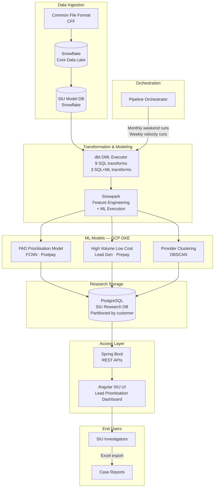

# System Architecture — PAD (Provider Anomaly Detection)

*Healthcare Fraud Detection AI · PM Case Study · Carelon (Elevance Health)*

---

## High-Level System Design

---

## Data Flow Detail

### 1. Ingestion
- Claims and provider data standardized into **Common File Format (CFF)** — ensures consistent structure across sources
- Loaded into **Snowflake** (core commercial provider + claims data)
- Subset transformed into dedicated **SIU Model Database** for investigation-specific analysis

### 2. Transformation
- **dbt** orchestrates 12 data models:
  - 9 pure SQL transformations (rule-based analytics)
  - 3 SQL + ML (hybrid — rules inform ML features)
- **Snowpark** handles complex feature engineering and ML execution within Snowflake, minimizing data movement

### 3. Scheduling
| Cadence | Timing | Purpose |
|---|---|---|
| Monthly | Weekend, mid-month | Previous month's full claims data |
| Weekly velocity | Wednesday evenings | More frequent refresh for active investigations |

### 4. ML Models
Two primary models in PAD:
- **PAD Prioritisation** (postpay): Scores existing claims for FWA likelihood
- **High Volume Low Cost Lead Gen** (prepay): Identifies anomalies before claims are adjudicated

Model deployment: GCP GKE via MLOps pipeline. One model = one API architecture.

### 5. Research Storage
- **PostgreSQL** research database partitioned by customer (payer) schema
- ~25 tables per payer segment for granular analysis
- Keeps research data separate from core claims lake

### 6. SIU Interface
- **Spring Boot REST APIs** abstract data model complexity
- **Angular SPA** provides multi-tab, multi-table interface
- **Excel export** for case documentation and supervisory review
- **Decision tree visualization** — investigators can trace why a case was flagged

---

## Technology Stack

| Layer            | Technology                 |
| ---------------- | -------------------------- |
| Data lake        | Snowflake                  |
| Transformation   | dbt (data build tool)      |
| ML execution     | Snowpark (in-Snowflake ML) |
| Cloud            | GCP (storage, compute)     |
| ML deployment    | GCP GKE via MLOps pipeline |
| Research storage | PostgreSQL                 |
| API              | Spring Boot REST           |
| Frontend         | Angular SPA                |
| Orchestration    | Pipeline Orchestrator      |

---

## PM Design Notes

### Why Decision Tree + FCNN (not just FCNN)?
FCNN was the top-performing model on holdout data. But investigators needed to explain their case decisions to supervisors and legal — a probability score wasn't enough. Decision Tree paths were included specifically for **investigator explainability** — a UX requirement, not a technical one.

### Why Snowpark over external ML pipeline?
Minimizes data movement between Snowflake and an external ML environment. At claims data scale (1M+ records monthly), moving data out of Snowflake adds latency and cost. Snowpark lets ML run where the data lives.

### Why PostgreSQL for research, not Snowflake?
Customer-partitioned schemas (25 tables per customer) benefit from PostgreSQL's relational query patterns for complex investigator research workflows. Snowflake handles bulk analytics; PostgreSQL handles granular case research.
