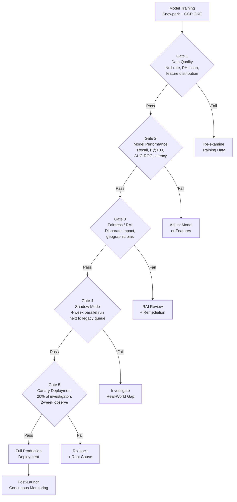

# AI Evaluation and Post-Launch Monitoring — Healthcare Fraud Detection (PAD)

*How a CI/CD evaluation pipeline and behavioral monitoring made a healthcare AI product trustworthy enough to use*
*PM Artifact · Carelon (Elevance Health) · Details adjusted for confidentiality*

---

> **On the numbers below:** Specific metrics are illustrative, adjusted from actuals for confidentiality. The structure — gates, thresholds, model comparison approach, shadow mode methodology, and monitoring framework — reflects the real approach used in production.

---

## Why Most AI Evaluation Fails

Most AI product teams evaluate models. They run holdout tests, compute AUC-ROC, and declare "good enough." Then they ship — and are surprised when users don't adopt it, trust it, or act on it.

**Model evaluation ≠ product evaluation.**

For PAD, the evaluation approach had two components that most teams skip:

1. **Pre-deployment:** A 5-gate CI/CD pipeline where no model could ship without passing all gates — including a 4-week shadow mode run alongside the legacy system
2. **Post-launch:** A behavioral monitoring framework where investigator override patterns were the primary quality signal, not offline metrics

This document covers both.

---

## The PM Methodology: Four Decisions Before Training Begins

Before any model is trained, four decisions determine whether you'll be evaluating the right thing. Getting these wrong after the fact is expensive.

### Decision 1: Error Asymmetry — Which mistake is more costly?

Every ML model makes two types of errors. The PM's job is to quantify the cost of each — so the optimization target is a business decision, not a technical default.

| Error Type | PAD (Healthcare Fraud) | Implication |
|---|---|---|
| **False Negative** (missed fraud) | $50K–$500K per case, unrecovered | Each missed case = direct financial loss |
| **False Positive** (clean claim flagged) | ~2–4 hours investigator time | Recoverable; investigators filter routinely |

**The ratio is not close.** One missed fraud case costs more than hundreds of false positive reviews. **Decision: optimize for recall.** See [recall-vs-precision-decision.md](recall-vs-precision-decision.md) for the full framework.

*For contrast:* At eBay, quality scoring for contact center agents inverted this decision — a false positive (scoring a good agent poorly) destroys supervisor trust immediately. Same type of ML scoring problem, opposite product decision, because the cost structure was different.

### Decision 2: Explainability — Does the user need to explain their decision downstream?

Not every model needs to explain itself. But if users will be audited, supervised, or challenged on their decisions, black-box scores create professional risk — and adoption fails.

**Explainability requirement check:**

- ☑ SIU investigators document every case decision (supervisory review)
- ☑ Output directly affects providers (financial and reputational consequence)
- ☑ Domain is regulated (healthcare; HIPAA; payment integrity audit trails)
- ☑ Users override model decisions — they need to know why it scored as it did

**Result: 3+ boxes checked → explainability is a core feature, not a compliance checkbox.**

Chosen approach: Decision Tree path visualization alongside FCNN score. SHAP values and reason codes were considered and rejected (see [problem-discovery-and-ux-strategy.md](problem-discovery-and-ux-strategy.md) — UX Decision 1).

### Decision 3: Define "Good Enough" Before You See Results

Acceptance thresholds must be written before model results are reviewed. After you see results, anchoring bias makes the threshold negotiation a political process, not a product one.

**For PAD — written before training began:**

| Metric | Minimum | Target | Rationale |
|---|---|---|---|
| Recall | ≥ 70% | ≥ 80% | Cost asymmetry: missed fraud >> false positive time |
| Precision@100 | ≥ 40% | ≥ 60% | Investigator capacity: < 40% destroys adoption |
| AUC-ROC | ≥ 0.80 | ≥ 0.88 | General class separation baseline |
| Inference time | < 2s/batch | < 0.5s | UI responsiveness for live queue updates |

Note on Precision@100: more operationally useful than global precision. Of the top 100 leads the model surfaces, how many become active cases? Directly maps to investigator weekly capacity.

### Decision 4: What Does Post-Launch Success Look Like (Beyond Accuracy)?

Model performance metrics measure the model. They don't measure whether investigators are using it, trusting it, or getting value from it.

**PAD success metrics hierarchy:**

```
LEVEL 1: USER BEHAVIOR (daily — fastest, most actionable)
├── Override rate by engine (investigators skipping top-ranked leads)
├── Time-to-first-action (how long before a lead is opened)
└── Queue utilization rate (% of cases accessed via PAD vs legacy)

LEVEL 2: OUTPUT QUALITY (weekly check)
├── Precision@100 (of top 100 leads, how many become active cases?)
├── Case conversion rate (flagged leads → active investigations)
└── Lead volume trend vs. prior month

LEVEL 3: MODEL HEALTH (monthly check)
├── Feature distribution drift (are input features shifting from training baseline?)
├── Prediction score distribution (are scores shifting over time?)
└── Recall vs. validated leads (confirmed fraud: were they scored high?)

LEVEL 4: FAIRNESS / RAI (monthly check)
├── Flagging rate by provider type, geography, specialty
├── Override rate by provider demographic
└── Case conversion equity across provider segments
```

Agree on this hierarchy before launch. If you define it after a problem surfaces, you're diagnosing without a baseline.

---

## RAI Governance: Embedded, Not Bolted On

RAI in healthcare AI is not a Gate 3 checkbox and a post-launch audit. It's a series of product decisions distributed across the entire build-deploy-monitor cycle.

### Pre-Build: Stakes Definition

| Decision | PAD Approach |
|---|---|
| Who is affected by a model error? | Healthcare providers — financial and reputational consequences; patients indirectly |
| Which error is more costly? | False negative (missed fraud) >> false positive (investigator reviews clean claim) — documented before training |
| Can a wrong decision be corrected? | Yes: investigator reviews all output before case action; override mechanism built in |
| Human in the loop? | Mandatory — no model output triggers enforcement action without SIU investigator review |
| Regulatory exposure | HIPAA (PHI handling); payment integrity audit trail requirements |

### Data: What We Audited Before Feature Engineering

| Audit Area | What We Did |
|---|---|
| PHI/PII handling | Field-level data classification applied at ingestion; PHI scanning tooling required before any model ingestion |
| Protected attribute exclusion | ZIP code excluded (proxy for race/SES); provider specialty retained with ongoing disparate impact audit |
| Proxy feature audit | Geographic clustering reviewed for rural/urban bias; rural access patterns ≠ fraud patterns (caught in shadow mode) |
| Historical bias check | Training data reviewed for legacy investigation bias — providers historically under-investigated not excluded from model scope |
| Data minimization | Only features with documented causal relationship to FWA included |

### Model: Fairness Gates

| Fairness Check | Threshold | PAD Result |
|---|---|---|
| Disparate impact ratio by geography | ≥ 0.80 | Rural providers: 1.3x average flag rate at Month 3 — within threshold |
| Disparate impact by provider specialty | No single specialty > 1.5x without equivalent case conversion | E1 oncology/dialysis issue caught via override rate — remediated Month 3 |
| Confidence calibration | Scores should reflect actual fraud probability | Calibration reviewed post-shadow mode |

### Deployment Safeguards

| Safeguard | Implementation |
|---|---|
| Human review gate | SIU investigator reviews all leads before case is opened — no automated enforcement |
| Override mechanism | [OPEN CASE] / [DEFER] / [NOT FWA — CLOSE] — all captured with timestamp and engine |
| Audit trail | Every lead stores: engine version, features that drove score, decision tree path, investigator action + timestamp |
| Incident response | Override rate > 50% sustained 2 months → investigate model quality; suspend engine if no root cause |
| Sunset criteria | Recall drops > 20% month-over-month → retraining; disparate impact confirmed → escalate to RAI review |

### Communication: What Investigators Were Told

- Investigators were informed the queue was ML-powered and could surface leads not visible in legacy tools
- Decision tree path was designed specifically to communicate model reasoning in investigator-legible terms
- Confidence was communicated through multi-engine flags ("flagged by all 3 engines = highest confidence"), not raw probability scores
- Investigators could override and were told their overrides were tracked and used to improve quality

---

## Part 1: Pre-Deployment — The 5-Gate CI/CD Pipeline

Every model version passed through a structured evaluation pipeline before reaching investigators. Gates were sequential: a failure at any gate stopped deployment.

```
GATE 1             GATE 2             GATE 3           GATE 4            GATE 5
Data Quality  →  Model Performance  →  Fairness/RAI  →  Shadow Mode  →  Canary Deploy
    ↓                  ↓                   ↓                ↓                ↓
Pass → next    Pass → next         Pass → next      Pass → next     Pass → Full Deploy
Fail → retrain  Fail → retrain      Fail → RAI review  Fail → retrain  Fail → Rollback
```



### Gate Acceptance Criteria (defined before training began)

| Gate | Criteria | Threshold | Rationale |
|---|---|---|---|
| **Gate 1: Data Quality** | Null rate on key features | < 5% | Sparse features corrupt model inputs |
| | PHI/PII scan result | Must pass | Regulatory compliance |
| | Feature distribution vs. training baseline | Within 2σ | Detect data pipeline issues early |
| **Gate 2: Model Performance** | Recall | ≥ 70% minimum | Missed fraud cost >> false positive cost |
| | Precision@100 | ≥ 40% | Investigator time capacity constraint |
| | AUC-ROC | ≥ 0.80 | Baseline class separation quality |
| | Inference time per batch | < 2s | UI responsiveness for live queue updates |
| **Gate 3: Fairness/RAI** | Disparate impact ratio | ≥ 0.80 across geographic regions | No region flagged at 1.25x+ average without equivalent conversion |
| | Protected attribute exposure | None in model features | Proxy audit: ZIP code excluded, specialty retained with audit |
| **Gate 4: Shadow Mode** | Net-new leads vs. legacy | > 0% sustained 4 weeks | Model must find cases legacy misses |
| | Shadow precision consistency | Within 10% of holdout P@100 | Real-world performance must match lab |
| **Gate 5: Canary** | Override rate during canary | < 40% | High override signals trust or quality failure |
| | Precision@100 during canary | Within 10% of holdout | No significant production distribution shift |

---

### Step 2: Model Selection — 5 Models Evaluated

Five model types were trained on the same dataset and evaluated against the Gate 2 criteria. Acceptance criteria were written before any results were reviewed to prevent anchoring bias.

| Model | Recall | Precision@100 | AUC-ROC | Inference | Explainable? | Gate 2 Result | Decision |
|---|---|---|---|---|---|---|---|
| **FCNN** | **78%** | **48%** | **0.87** | **1.2s** | No (score only) | ✅ Pass | **Production model** |
| Gradient Boost | 74% | 51% | 0.84 | 0.8s | Partial (feature importance) | ✅ Pass | Rejected: lower recall vs FCNN |
| Random Forest | 68% | 44% | 0.81 | 0.6s | Partial (feature importance) | ❌ Fail | Recall below 70% minimum |
| Logistic Regression | 55% | 38% | 0.74 | 0.1s | Yes (coefficients) | ❌ Fail | Both recall and P@100 below threshold |
| **Decision Tree** | **61%** | **41%** | **0.76** | **0.2s** | **✅ Full path** | ❌ Fail | **Retained: explainability layer only** |

**PM decision note:** FCNN was selected as the production scoring model. Decision Tree did not meet performance thresholds and would not have been chosen on accuracy alone — but investigators needed to understand *why* a case was flagged before they'd act on it. A probability score from the FCNN wasn't enough.

The Decision Tree was retained as a parallel explainability layer: its path visualization (avg_charge > $2,400 → services_per_patient > 12 → specialty_deviation > 340% → SCORE: HIGH) was surfaced in the investigator UI alongside the FCNN score. Not the best predictor. The best explainer.

This was a product decision. It added engineering complexity (two models in production) to solve a user trust problem, not a technical one.

---

### Step 3: Acceptance Criteria — FCNN Results vs. Pre-Defined Thresholds

| Metric | Minimum Threshold | Target | FCNN Result | Met? |
|---|---|---|---|---|
| Recall | ≥ 70% | ≥ 80% | 78% | ✅ Above minimum, below target |
| Precision@100 | ≥ 40% | ≥ 60% | 48% | ✅ Above minimum, below target |
| AUC-ROC | ≥ 0.80 | ≥ 0.88 | 0.87 | ✅ Above minimum, approaching target |
| Inference time | < 2s per batch | < 0.5s | 1.2s | ✅ Within requirement |
| Lift over baseline | ≥ 30% | ≥ 50% | 41% | ✅ Above minimum |

**Decision:** FCNN cleared all minimum thresholds. Recall at 78% vs. an 80% target was acceptable given the cost asymmetry (missed fraud >> false positive time). The Gradient Boost model's higher precision (51%) was not a sufficient tradeoff for its lower recall (74%).

---

### Step 4: Shadow Mode — 4-Week Parallel Run

Before replacing the legacy lead queue, PAD ran in shadow mode alongside it for four weeks. Investigators used the legacy system as normal; PAD ran in parallel but outputs were not shown to them. At the end of each week, a data scientist reviewed the delta: which cases did PAD surface that the legacy system didn't?

Week 4 results were shown to investigators in a preview session before go-live: "Here are cases you would have missed last month."

| Week | PAD Leads Generated | Legacy Leads | Net-New (PAD only) | Preview Outcome |
|---|---|---|---|---|
| Week 1 | 47 | 38 | 14 | 3 confirmed new fraud patterns not in legacy queue |
| Week 2 | 52 | 41 | 17 | 4 confirmed; 1 specialty billing pattern flagged for review |
| Week 3 | 49 | 39 | 13 | 2 confirmed; geographic clustering anomaly identified in E1 |
| Week 4 | 51 | 38 | 16 | 2 confirmed; geographic bias catch → peer grouping refined before go-live |
| **Total** | **199** | **156** | **60** | **11 confirmed net-new fraud patterns; 1 model issue caught and fixed pre-launch** |

**What shadow mode caught before go-live:** Provider clustering in Engine 1 (DBSCAN) was flagging rural providers as anomalous because specialist access density is lower in rural areas — creating geographic signals that looked like fraud but reflected access patterns. Refining the peer comparison logic to control for rural/urban density before launch prevented this from surfacing to investigators.

Shadow mode is the most underused evaluation technique in enterprise AI. It builds investigator trust (they saw real evidence before the switch) and provides real-world precision data before the stakes were live.

---

## Part 2: Post-Launch — 6-Month Monitoring Dashboard

Model performance on a holdout set is not the same as product performance in production. The monitoring framework tracked both — and separated them deliberately.

### The Signal Hierarchy

Not all signals are equal. Here's how they were prioritized:

```
LEVEL 1: USER BEHAVIOR (daily — fastest, most actionable)
├── Override rate by engine (investigators skipping top-ranked leads)
├── Time-to-first-action (how long before a lead is opened)
└── Queue utilization rate (% of cases accessed via PAD vs legacy)

LEVEL 2: OUTPUT QUALITY (weekly check)
├── Precision@100 (of top 100 leads, how many become active cases?)
├── Case conversion rate (flagged leads → active investigations)
└── Lead volume trend vs. prior month

LEVEL 3: MODEL HEALTH (monthly check)
├── Feature distribution drift (are input features shifting from training baseline?)
├── Prediction score distribution (are scores shifting over time?)
└── Recall vs. validated leads (confirmed fraud: were they scored high?)

LEVEL 4: FAIRNESS / RAI (monthly check)
├── Flagging rate by provider type, geography, specialty
├── Override rate by provider demographic
└── Case conversion equity across provider segments
```

### 6-Month Post-Launch Metrics

| Month | P@100 | Case Conv. | Override — E1 | Override — E2 | Override — E3 | Queue Util. | Action |
|---|---|---|---|---|---|---|---|
| Month 1 | 48% | 34% | 38% | 12% | 9% | 71% | Baseline established |
| Month 2 | 49% | 38% | 41% | 11% | 8% | 83% | E1 override pattern identified; specialty segmentation analysis started |
| Month 3 | 51% | 41% | 43% | 10% | 8% | 89% | Root cause confirmed; E1 clustering logic refined with stratified peer groups |
| Month 4 | 54% | 44% | 26% | 10% | 9% | 91% | E1 override improvement confirms fix |
| Month 5 | 56% | 46% | 21% | 11% | 8% | 93% | Stable; monitoring continues |
| Month 6 | 58% | 47% | 18% | 10% | 9% | 94% | Monthly model refresh completed |

**Reading the table:**
- P@100 and case conversion both improved month-over-month — the model gets better as the training data grows
- Queue utilization reaching 94% by Month 6 indicates investigators have adopted PAD as their primary tool, not a supplement
- E1 override rate is the diagnostic story (see below)
- E2 and E3 override rates stayed consistently low — those engines' outputs were more consistently trusted

---

### Override Rate as a Diagnostic Tool

Override rate = investigators mark a lead as non-priority after opening it. This is the most actionable monitoring signal because it's a direct user judgment on model quality, available in near-real-time — no waiting for case outcomes.

**The E1 Diagnosis — Month 2–3:**

Engine 1's elevated override rate wasn't random. Drilling into the pattern:

| Provider Specialty | Override Rate | Peer Group Used | Root Cause | Resolution |
|---|---|---|---|---|
| Oncology centers | 73% | General practitioners | High procedure volume flagged as anomaly vs. GPs | Stratified peer groups by specialty type |
| Dialysis clinics | 68% | General practitioners | High session frequency misread vs. GP baseline | Specialty-specific volume benchmarks |
| Cardiology (private practice) | 34% | Cardiology (hospital-based) | Practice type mismatch in peer assignment | Sub-group by practice setting |
| General practitioners | 8% | General practitioners | Correct peer grouping | No action |

**Investigator quote that surfaced the issue:**
> *"The oncology leads are wasting my time. Those places aren't fraudulent — they just see a lot of cancer patients."*

This wasn't an investigator trust problem. It was a model quality problem: the DBSCAN clustering was comparing specialty providers to a general population baseline. Oncology centers and dialysis clinics have high procedure volumes, high costs per session, and high visit frequencies — not because they're committing fraud, but because of the nature of what they treat.

Refining the peer grouping to segment by specialty type (oncology vs. cardiology vs. GP) resolved the root cause. E1 override rate dropped from 41% to 18% over two months.

**The lesson:** High override on a specific lead type is almost always a peer comparison or feature engineering issue — not a model trust issue. Diagnose by specialty, geography, and engine before assuming investigators are wrong.

---

### Month 3 Model Review — Filled-In Example

```
MODEL PERFORMANCE REVIEW — Month 3

1. Lead volume
   203 leads generated (vs 198 Month 2, 201 3-month avg) — stable, expected.

2. Precision@100: 51%
   Up from 49% (Month 2). Still below 60% target; above 40% minimum.
   Trending in the right direction. No action.

3. Case conversion: 41%
   Up from 38% (Month 2). Positive signal — investigators opening leads are
   finding more that are worth pursuing. Tied to E1 override reduction beginning.

4. Override rate: 20% overall
   E1: 43% (⚠️ HIGH — primary issue this month)
   E2: 10% ✅
   E3: 8%  ✅
   E1 elevated override confirmed from Month 2 pattern.
   Root cause now confirmed: specialty providers vs. GP peer grouping.

5. Feature drift check: ⚠️ YELLOW
   specialty_code distribution shifted after Q3 billing cycle (+0.8σ from training baseline).
   Not model-threatening; flagged for monitoring. No retraining triggered.

6. Investigator feedback (SIU team survey)
   "The oncology leads are wrong — those providers are just high-volume by nature."
   Matches E1 override pattern. Qualitative signal consistent with quantitative.

7. Fairness check: ✅ GREEN
   Rural provider flagging rate: 1.3x average — within acceptable range (threshold: 1.5x).
   No provider demographic group above threshold.
   Geographic bias issue from shadow mode pre-launch has not re-emerged.

ACTIONS:
  ✅ E1 clustering logic: DS team refining peer grouping to segment by specialty_type.
     Scope: oncology, dialysis, cardiology (private), cardiology (hospital), GP.
     Target: deployed before Month 4 review.
  ✅ specialty_code drift: schedule monitoring ahead of Q4 billing cycle.
     No retraining triggered. Flag for Month 4 review.

Retraining triggered? No. All metrics within acceptable thresholds.
Next scheduled refresh: Month 6 (full claims data + velocity run catch-up).
```

---

## Part 3: RAI Monitoring (Ongoing)

RAI governance isn't a pre-launch checklist. It's a continuous practice.

### Monitoring Thresholds (defined pre-launch, reviewed monthly)

| Condition | Response |
|---|---|
| Override rate > 50% sustained 2 months | Investigate model quality; suspend engine if no root cause found |
| Case conversion drops > 30% from baseline | Investigate lead quality; pause new leads pending review |
| Recall drops > 20% month-over-month | Trigger retraining |
| Disparate impact confirmed by audit | Escalate to RAI review; pause flagging for affected provider group |
| Regulatory change affecting detection criteria | Emergency retraining protocol |

### Audit Trail Requirements

Every model-generated lead stored:
- Which engine scored it and which model version
- Which features drove the score (decision tree path for E2)
- Timestamp and model version at scoring time
- Investigator action (opened / deferred / overridden) and timestamp

This isn't just for compliance. When override rates spike, the audit trail is the diagnostic tool.

---

## The PM Takeaway

Shipping a model is the beginning of the work, not the end.

The failure mode isn't usually "the model degrades." It's "the model degrades quietly, nobody notices for 6 months, and by then investigators have gone back to their old tools because 'the AI doesn't work.'"

For PAD, the post-launch monitoring framework caught a significant model quality issue at Month 2 — before it became a trust failure. Override rate was the signal. Specialty segmentation analysis was the diagnosis. Stratified peer groups were the fix. This sequence only works if you're watching the right metrics.

**Model performance metrics measure the model. Product metrics measure whether it's working for people.**

The two are not the same. Both matter. Only one tells you whether to ship.
